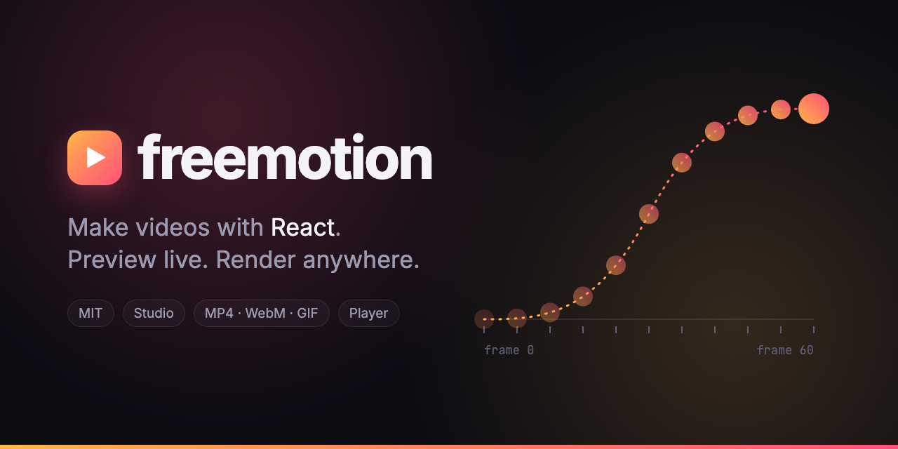
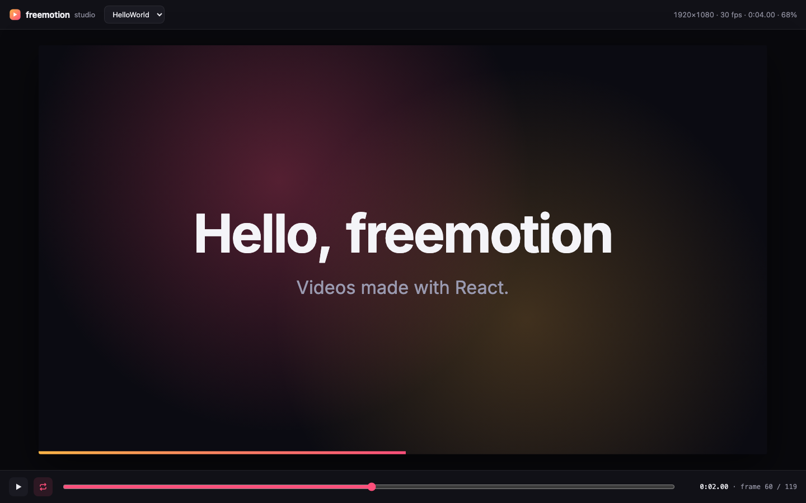

<p align="center">
  
</p>

<p align="center">
  Write videos as React components. Every frame is a function of time, so you can <b>preview</b> them live in the studio, <b>render</b> them to MP4, WebM, GIF or PNG, and <b>play</b> them inside any web page, even driven by the scroll.
</p>

<p align="center">
  <a href="LICENSE"></a>
  <a href="https://www.npmjs.com/package/freemotion"></a>
  <a href="https://www.npmjs.com/package/freemotion"></a>
  = 20.19">
  
  
  <a href="https://github.com/douglasjunior/freemotion/pulls"></a>
</p>

<p align="center">
  <a href="#-quick-start"><b>Quick Start</b></a> ·
  <a href="#-why-freemotion">Why</a> ·
  <a href="#-how-it-works">How It Works</a> ·
  <a href="#-studio">Studio</a> ·
  <a href="#-rendering">Rendering</a> ·
  <a href="#-player">Player</a> ·
  <a href="#-api">API</a> ·
  <a href="#-coming-from-remotion">Coming from Remotion</a> ·
  <a href="#-examples">Examples</a>
</p>

---

<p align="center">
  
  <br>
  <sub>This video is a freemotion composition. <a href="https://github.com/douglasjunior/freemotion-examples/tree/main/src/showcase">See its source</a>.</sub>
</p>

## 🚀 Quick Start

```bash
npx freemotion init my-video
cd my-video
npm install
npm run studio     # preview with hot reload
npm run render     # out/HelloWorld.mp4
npm run page       # a page that plays the Story video as you scroll
```

The new project has two compositions to start from: `HelloWorld` (springs, `interpolate()`, a `<Sequence>`) and `Story` (steps chained with `<Series>`), plus a small Vite page in `page/` that plays `Story` with [`<ScrollPlayer>`](#scroll-driven-video).

You only need **Node.js 20.19+** (or 22.12+). New projects come with [`ffmpeg-static`](https://www.npmjs.com/package/ffmpeg-static), which downloads an ffmpeg binary into the project, and the headless Chromium used for rendering is downloaded automatically on the first render.

<details>
<summary><b>About ffmpeg and its license</b></summary>

freemotion encodes videos by running ffmpeg as a separate program. It looks for it in this order: `--ffmpeg <path>`, the `FREEMOTION_FFMPEG` environment variable, the project's `ffmpeg-static` package, and finally `ffmpeg` on your `PATH`. Prefer a system install? Remove `ffmpeg-static` and run `brew install ffmpeg`, `sudo apt install ffmpeg` or `winget install ffmpeg`.

The ffmpeg binaries that `ffmpeg-static` downloads are GPL-licensed. They live in your project as a regular dependency: freemotion doesn't ship, bundle or link them, so freemotion itself stays MIT, and the videos you render are yours under any license you like. The GPL only matters if you redistribute the ffmpeg binary itself, for example inside an app or a Docker image you publish.

</details>

## 💡 Why freemotion?

- ⚛️ **It's just React.** Components, props, hooks, CSS, SVG, fonts and any npm package. If it renders in a browser, it renders in your video.
- 🎞️ **Frame-perfect by design.** Everything derives from `useCurrentFrame()`. Any frame can be drawn on its own, in any order, so renders are deterministic and run in parallel.
- ⚡ **Fast.** Several Chromium tabs capture frames at once and stream them straight into ffmpeg. The 10-second, 720p video above renders in about 5 seconds on a laptop.
- 🔥 **A live studio.** Scrub the timeline, step frame by frame, switch compositions and see every edit instantly with hot reload.
- 🌐 **Plays on the web, too.** `<Player>` runs any composition inside a React page, and `<ScrollPlayer>` turns the page scroll into the timeline: scroll down to play, up to rewind.
- 🧩 **Built on Vite.** Your `vite.config`, aliases, CSS tooling and plugins keep working. `public/` files are served as they are.
- 🆓 **MIT, all of it.** The studio, the renderer and the player are free for any use, at any company size. No tiers, no seats, no render fees.
- 🔁 **A familiar API.** Coming from Remotion? `useCurrentFrame`, `interpolate`, `spring`, `Sequence` and friends have the same names. [See the differences](#-coming-from-remotion).

## 🧠 How It Works

A **composition** is a React component plus its size, frame rate and duration. Your project exports a list of them:

```tsx
// src/compositions.tsx
import { defineComposition } from 'freemotion';

import { Intro } from './Intro';

export default [
  defineComposition({
    id: 'Intro',
    component: Intro,
    defaultProps: { title: 'Hello' },
    fps: 30,
    width: 1920,
    height: 1080,
    durationInFrames: 150, // 5 seconds
  }),
];
```

Inside the component, read the current frame and compute everything from it:

```tsx
// src/Intro.tsx
import { AbsoluteFill, interpolate, Sequence, spring, useCurrentFrame, useVideoConfig } from 'freemotion';

export const Intro = ({ title }: { title: string }) => {
  const frame = useCurrentFrame();
  const { fps } = useVideoConfig();

  const scale = spring({ frame, fps, config: { damping: 12 } });
  const opacity = interpolate(frame, [0, 20], [0, 1], { extrapolateRight: 'clamp' });

  return (
    <AbsoluteFill style={{ background: '#0b0b12', alignItems: 'center', justifyContent: 'center' }}>
      <h1 style={{ color: 'white', fontSize: 140, opacity, transform: `scale(${scale})` }}>{title}</h1>
      <Sequence from={45}>
        {/* Inside a Sequence, useCurrentFrame() starts at 0 on frame 45. */}
        <Subtitle />
      </Sequence>
    </AbsoluteFill>
  );
};
```

No timers, no `useEffect` animations, no CSS transitions: the frame **is** the time. That's what lets the studio jump to any frame, the renderer draw frames in parallel, and a web page scrub the video with the scroll.

Under the hood:

| | |
|---|---|
| **`freemotion studio`** | Starts a Vite dev server whose home page is the studio, with your compositions loaded and hot reload on. |
| **`freemotion render`** | Bundles the project with Vite, opens it in several headless Chromium tabs and, for each frame, draws it, waits for fonts, images and [`delayRender()`](#async-data-delayrender) holds, captures a PNG and pipes it to ffmpeg, in order. For an [animated SVG](#animated-svg), one tab records the DOM of every frame instead. |
| **`<Player>`** | Draws a composition inside your own React app, scaled to fit its container. |

## 🎬 Studio

```bash
npx freemotion studio
```

<p align="center">
  
</p>

| Key | Action |
|---|---|
| <kbd>Space</kbd> | Play / pause |
| <kbd>←</kbd> <kbd>→</kbd> | Previous / next frame |
| <kbd>Shift</kbd> + <kbd>←</kbd> <kbd>→</kbd> | One second back / forward |
| <kbd>Home</kbd> <kbd>End</kbd> | First / last frame |
| <kbd>L</kbd> | Toggle loop |

The URL keeps the composition and the frame (`?composition=Intro&frame=42`), so reloading or sharing a link lands on the same picture. Compositions with a `folder` are grouped in the picker.

## 📦 Rendering

```bash
npx freemotion render Intro                      # out/Intro.mp4
npx freemotion render Intro -o promo.webm        # VP9 WebM
npx freemotion render Intro -o promo.gif         # animated GIF
npx freemotion render Intro -o promo.gif --scale 0.5 --every-nth-frame 2   # half size, 15 fps
npx freemotion render Intro -o banner.svg        # animated SVG, no ffmpeg needed
npx freemotion render Intro --frame 60           # out/Intro.png, a still
npx freemotion render Intro --frames 0-89        # only the first 3 seconds
npx freemotion render Intro --scale 2            # twice the width and height
npx freemotion render Intro --props '{"title":"Launch day"}'
npx freemotion render --all                      # every composition, to out/
```

| Format | Encoder | Notes |
|---|---|---|
| `.mp4` | H.264, yuv420p, CRF 18 | Tagged BT.709, `+faststart` for the web. Width and height must be even. |
| `.webm` | VP9, CRF 32 | Needs an ffmpeg built with `libvpx`. |
| `.gif` | Palette per video | For lighter files, shrink it with `--scale 0.5` and drop frames with `--every-nth-frame 2`. |
| `.png` | Lossless | A single frame (`--frame`). ffmpeg is not needed. |
| `.svg` | CSS keyframes | A vector file that plays by itself, in browsers and GitHub READMEs. ffmpeg is not needed. See [Animated SVG](#animated-svg). |

<details>
<summary><b>All render options</b></summary>

```text
-o, --output <file>         Output file, for a single composition (.mp4, .webm, .gif, .png or .svg)
--out-dir <dir>             Folder for <id>.<format> files (default: out)
--all                       Render every composition
--format <format>           mp4, webm, gif, png or svg (default: from --output, else mp4; png with --frame)
--frame <n>                 Render a still image of frame n
--frames <a-b>              Render only frames a to b (inclusive)
--every-nth-frame <n>       Keep one frame out of every n, at 1/n of the frame rate (lighter GIFs and SVGs)
--no-loop                   GIF and SVG: stop on the last frame instead of starting over
--props <json|file>         Props merged over defaultProps, as JSON or a path to a .json file
--scale <n>                 Pixel density: 2 renders at twice the width and height (default: 1)
--crf <n>                   Quality for mp4/webm, lower is better (default: 18 mp4, 32 webm)
--concurrency <n>           Browser tabs rendering in parallel (default: CPU cores - 2, up to 8)
--entry <file>              File that exports the compositions (default: src/compositions.tsx)
--config <file>             Vite config to merge (default: vite.config.* in the project)
--no-config                 Ignore the project's Vite config
--ffmpeg <path>             ffmpeg binary (default: $FREEMOTION_FFMPEG, the project's ffmpeg-static, or ffmpeg on PATH)
--browser-executable <path> Chromium/Chrome to use instead of the bundled headless shell
--quiet                     Only print errors
```

</details>

### Animated SVG

```bash
npx freemotion render Banner -o banner.svg                  # loops, like a GIF
npx freemotion render Banner -o banner.svg --no-loop        # plays once and stays on the last frame
npx freemotion render Banner -o banner.svg --frame 30       # a still, as vectors
```

The same composition, the same frames, as one `.svg` file: text stays text, edges stay sharp at any size, and the file is usually far smaller than a GIF. Put it in a README with ``, in a web page inline or as ``, or anywhere else a browser engine draws SVG.

How it's made: the renderer draws every frame as usual, but instead of a screenshot it records the DOM of the stage. Whatever changed from one frame to the next (an inline style, an SVG attribute, an element that mounted or unmounted, a text that counts) becomes CSS `@keyframes` that step at the frame rate; the rest is written once. The markup goes inside a `<foreignObject>`, so it is the HTML your components produced, along with the stylesheets, the images and the font faces it uses, embedded as `data:` URLs so the file stands alone.

What to know:

- **It needs a browser engine.** Chrome, Edge, Firefox and Safari from 2024 on play it, inline or as ``. Design tools such as Inkscape, Illustrator or Figma don't render `<foreignObject>`, and `` can't run scripts, which is why everything is CSS.
- **Size grows with change.** A value that moves every frame costs one keyframe per frame. Elements whose attributes CSS can't animate (a `<path d>` that morphs, an `` that swaps) are written once per distinct value. `--every-nth-frame 2` halves all of it. Fonts are embedded only for the faces and the characters the video uses, but a font family can still weigh a few hundred KB.
- **Not everything survives.** `<canvas>` is captured as one image per frame (heavy), `<video>` and WebGL don't play, shadow DOM is not recorded, and stylesheet rules must target elements inside the composition (`body` and `html` don't exist in the file). Where the composition paints nothing, the SVG is transparent, where a video would be white.
- **Timing is frame-exact.** Each keyframe holds for one frame of the original frame rate, like the video. The `--scale`, `--crf` and `--concurrency` options don't apply.

### Tips for identical renders everywhere

- **Bundle your fonts** with a package such as [`@fontsource`](https://fontsource.org) instead of relying on fonts installed on the machine. The renderer waits for every font face to load.
- **Derive everything from the frame.** CSS animations, transitions and timers run on the wall clock and won't match between tabs. Use `interpolate()` and `spring()` instead.
- **Use `random(seed)`** instead of `Math.random()`: the same seed gives the same number in every tab and on every machine.
- **Wait for async data** with [`delayRender()`](#async-data-delayrender).

## 🌐 Player

Play a composition inside any React app. It fits the width of its container and keeps the aspect ratio.

```tsx
import { Player } from 'freemotion';

import { intro } from './compositions';

// Plays by itself, in a loop:
<Player composition={intro} autoPlay />

// Or controlled: you choose the frame (from a slider, a timer, the scroll…):
<Player composition={intro} frame={frame} inputProps={{ title: 'Hi' }} />
```

| Prop | Type | Default | Description |
|---|---|---|---|
| `composition` | `Composition` | | What to play, from `defineComposition()`. |
| `inputProps` | `Partial<Props>` | | Merged over the composition's `defaultProps`. |
| `frame` | `number` | | Controlled mode: the frame to draw. Rounded and clamped. |
| `autoPlay` | `boolean` | `false` | Uncontrolled mode: start playing on mount. |
| `loop` | `boolean` | `true` | Uncontrolled mode: start over at the end. |
| `playbackRate` | `number` | `1` | Uncontrolled mode: speed multiplier. |
| `onFrameChange` | `(frame) => void` | | Uncontrolled mode: called on every new frame. |
| `style`, `className` | | | Applied to the container. |

### Scroll-driven video

`<ScrollPlayer>` renders a tall section with the player stuck to the viewport. While the section scrolls by, the scroll position picks the frame; when it ends, the video leaves with the page. Wheel steps are eased so the motion glides, and `prefers-reduced-motion` turns the easing off.

```tsx
import { ScrollPlayer } from 'freemotion';

<ScrollPlayer composition={intro} scrollLength="500vh" />
```

| Prop | Type | Default | Description |
|---|---|---|---|
| `composition`, `inputProps` | | | As in `<Player>`. |
| `scrollLength` | CSS height | `'400vh'` | Height of the section: the longer, the slower the video advances. |
| `smoothing` | `number` (ms) | `120` | How long the shown frame takes to catch up with the scroll. `0` follows it exactly. |
| `width` | CSS width | fits the viewport | Width of the player. |
| `onFrameChange` | `(frame) => void` | | Called with the frame shown, e.g. to sync captions outside the video. |
| `stickyStyle`, `playerStyle`, `className` | | | Styles of the sticky box, the player and the section. |
| `children` | `ReactNode` | | Rendered in the sticky box, below the player. |

For your own layout, `useScrollFrame()` returns the frame and you place the `<Player>`:

```tsx
const target = useRef<HTMLDivElement>(null);
const frame = useScrollFrame(target, intro.durationInFrames, {
  range: 'visible',      // 'sticky' (default): while a tall section scrolls by
                         // 'visible': from entering the viewport to leaving it
  container: scrollBox,  // an element that scrolls, instead of the page
  axis: 'x',             // horizontal scrolling
  smoothing: 0,
});

<div ref={target}><Player composition={intro} frame={frame} /></div>
```

The [examples repository](https://github.com/douglasjunior/freemotion-examples/tree/main/web) has a complete page.

## 📚 API

Everything is exported from `freemotion`.

| Export | What it does |
|---|---|
| `defineComposition(definition)` | Declares a composition: `id`, `component`, `defaultProps`, `fps`, `width`, `height`, `durationInFrames` and an optional `folder`. |
| `useCurrentFrame()` | The frame being drawn. Relative to the start of the enclosing `<Sequence>`. |
| `useVideoConfig()` | `{ fps, width, height, durationInFrames }` of the composition. |
| `interpolate(input, inputRange, outputRange, options?)` | Maps a value between ranges, segment by segment, with `easing` and `extrapolateLeft`/`extrapolateRight` (`'extend'`, `'clamp'`, `'identity'` or `'wrap'`). |
| `spring({ frame, fps, config?, from?, to?, delay? })` | A physical spring from `from` to `to`. `config`: `damping` (10), `mass` (1), `stiffness` (100), `overshootClamping` (false). |
| `Easing` | `linear`, `ease`, `quad`, `cubic`, `poly(n)`, `sin`, `circle`, `exp`, `elastic(b)`, `back(s)`, `bounce`, `bezier(x1, y1, x2, y2)` and the modifiers `in`, `out`, `inOut`. |
| `<AbsoluteFill>` | A full-size, absolutely positioned flex column. The basic layer. |
| `<Sequence from durationInFrames layout>` | Shifts time for its children and mounts them only during its window. |
| `<Series>` / `<Series.Sequence durationInFrames offset>` | Plays sequences one after the other. A negative `offset` overlaps them. |
| `` | An `` that holds the render until it has loaded. |
| `staticFile(path)` | URL of a file in `public/`, respecting Vite's `base`. |
| `delayRender(label?)` / `continueRender(handle)` / `cancelRender(error)` | Hold the render while something asynchronous loads. |
| `random(seed)` | A deterministic number in `[0, 1)` for a seed. |
| `<Player>` | Plays a composition in a web page. [See above](#-player). |
| `<ScrollPlayer>` / `useScrollFrame(target, durationInFrames, options?)` | Drive a composition with the page scroll or any scrolling element. [See above](#scroll-driven-video). |
| `scrollProgress(start, size, viewport, range?)` | The scroll math behind them, as a pure function, for custom integrations. |
| `<Stage config frame>` | Draws one frame at native size. The building block of the player, the studio and the renderer. |

### Async data: `delayRender()`

```tsx
const [data, setData] = useState<Data | null>(null);
const [handle] = useState(() => delayRender('Loading stats'));

useEffect(() => {
  fetch(staticFile('stats.json'))
    .then(response => response.json())
    .then((json) => {
      setData(json);
      continueRender(handle);
    })
    .catch(cancelRender);
}, [handle]);
```

The renderer waits until every hold is released before capturing a frame. A hold that isn't released within 30 seconds fails the render with its label (configure it with `delayRender(label, { timeoutInMilliseconds })`).

## 🔁 Coming from Remotion?

freemotion keeps the names you already know, so most components move over by changing the import:

```diff
- import { AbsoluteFill, interpolate, spring, useCurrentFrame } from 'remotion';
+ import { AbsoluteFill, interpolate, spring, useCurrentFrame } from 'freemotion';
```

Same names: `useCurrentFrame`, `useVideoConfig`, `interpolate`, `spring`, `Easing`, `AbsoluteFill`, `Sequence`, `Series`, `Img`, `staticFile`, `delayRender`, `continueRender`, `cancelRender` and `random`.

What's different:

- **Registering compositions.** Instead of `<Composition>` elements under `registerRoot()`, `src/compositions.tsx` default-exports an array built with `defineComposition()`.
- **The `<Player>`** takes the composition object (`composition={intro}`) and is controlled through its `frame` prop.
- **Not there yet:** audio, `<Video>`/`<OffthreadVideo>`, transparent video, `calculateMetadata()` and cloud rendering.

freemotion is an independent project written from scratch, and it is not affiliated with Remotion.

## 🧪 Examples

**[douglasjunior/freemotion-examples](https://github.com/douglasjunior/freemotion-examples)** has the video at the top of this page, the banner, a bar chart that loads its data with `delayRender()`, and a page where the video plays as you scroll.

## 🗺️ Roadmap

- [ ] Audio tracks and `<Audio>`
- [ ] `<Video>` with frame-accurate seeking
- [ ] Transparent output (ProRes 4444, VP9 with alpha)
- [ ] A render button and a props editor in the studio
- [ ] More `freemotion init` templates

Ideas and pull requests are welcome: [open an issue](https://github.com/douglasjunior/freemotion/issues).

## 🤝 Contributing

1. Read [`AGENTS.md`](AGENTS.md) for the architecture and conventions.
2. Fork the repository and create a topic branch.
3. Make sure `npm run ts`, `npm run lint`, `npm test` and `npm run test:e2e` pass. The e2e suite renders real videos, so it needs ffmpeg on your `PATH`.
4. Write commit messages following [Conventional Commits](https://www.conventionalcommits.org/) in English and open a pull request.

## ⭐ Star History

If freemotion saved you a render bill, consider giving it a star. It helps other people find the project.

<a href="https://star-history.com/#douglasjunior/freemotion&Date">
  <picture>
    <source media="(prefers-color-scheme: dark)" srcset="https://api.star-history.com/svg?repos=douglasjunior/freemotion&type=Date&theme=dark">
    
  </picture>
</a>

## 📄 License

[MIT](LICENSE) © Douglas Nassif Roma Junior
